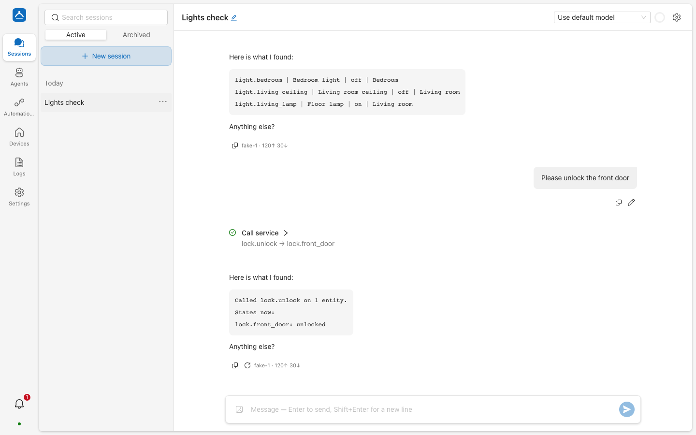
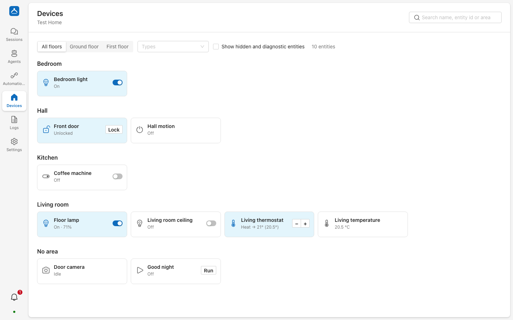
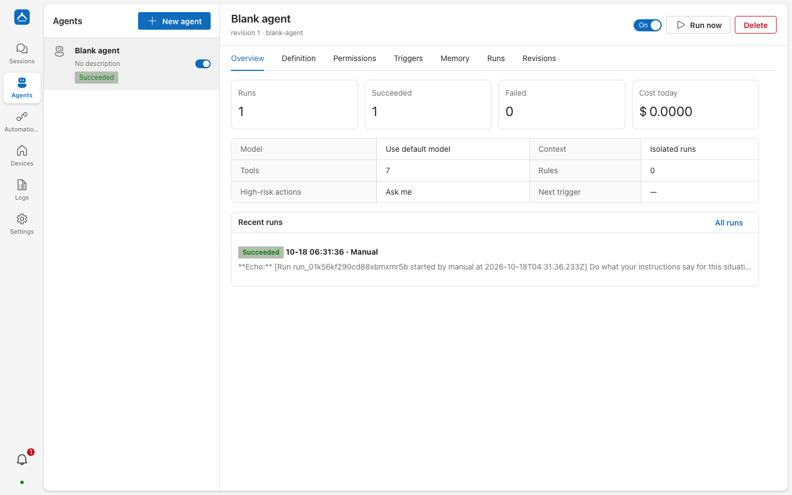

# 藏泽 · Cangze

> 夫藏舟于壑，藏山于泽，谓之固矣。 ——《庄子·大宗师》

**藏泽**是一款开源、私有部署的 AI 智能家居中枢，连接你已经在用的 Home Assistant。它通过 HA 的
WebSocket / REST API 接入（不需要安装 HA 插件或集成），让大语言模型安全地理解、控制和自动化你的家。

[English](README.md)

> **状态：0.3.0 预发布版。** 首个版本的功能已经齐备，并有单元测试与端到端测试覆盖，但项目仍然年轻。
> 请定期备份，遇到问题欢迎反馈。

<picture>
  <source media="(prefers-color-scheme: dark)" srcset="docs/images/session-dark.png">
  
</picture>

## 特性

- **会话**：可以创建任意多个平等的会话，各自拥有模型、上下文与历史，支持分支，工具调用实时可见。
- **子代理**：全局共享的持久化 Agent，拥有独立记忆与对话。主会话负责创建和管理它们；子代理按定时或
  Home Assistant 事件运行，设备权限由后端强制执行（默认拒绝、识别区域/设备/标签、参数范围、高风险操作审批）。
- **深度集成 Home Assistant**：状态、历史、日志、统计、带 schema 校验的服务调用、区域/楼层/设备/标签、
  自动化、脚本、场景、日历、待办。
- **冲突处理**：人工操作优先、代理之间分优先级、防抖动、防循环触发。
- **审批**：开门锁、撤防、开车库门和修改配置等高风险操作会先在会话或通知中心征求你的同意。
- **备份**：定时与手动备份单个数据库文件，可用口令加密，在界面里一键恢复。
- **默认私有**：单容器、单个 SQLite 文件、凭据加密存储、无遥测；默认安全的网络策略，可选 Caddy HTTPS。

<table>
  <tr>
    <td><picture>
  <source media="(prefers-color-scheme: dark)" srcset="docs/images/devices-dark.png">
  
</picture></td>
    <td><picture>
  <source media="(prefers-color-scheme: dark)" srcset="docs/images/agent-dark.png">
  
</picture></td>
  </tr>
</table>

## 快速开始

```bash
mkdir cangze && cd cangze
VERSION=0.3.0
curl -fsSLO "https://github.com/IGNGserver/cangze/releases/download/v${VERSION}/compose.yaml"
docker compose up -d
docker compose logs cangze | grep -i bootstrap
```

Compose 文件从指定版本的 Release 资产下载，不从 `main` 获取。正式版也可以使用
`https://github.com/IGNGserver/cangze/releases/latest/download/compose.yaml` 获取最新正式版本。

浏览器打开 `http://<主机>:38417`，输入日志里的一次性引导码并设置管理员密钥，欢迎向导会引导你连接
Home Assistant（地址 + 专用用户的长期访问令牌）并添加模型服务：内置 OpenAI、Anthropic、DeepSeek、通义千问、
Gemini 等，也支持任意 OpenAI / Anthropic 兼容端点（Ollama、vLLM、LM Studio、各类网关）。

HTTPS、反向代理、备份与升级见 [docs/DEPLOYMENT.md](docs/DEPLOYMENT.md)。

## 文档

- [部署](docs/DEPLOYMENT.md) · [备份与恢复](docs/BACKUP_RESTORE.md)
- [权限模型](docs/PERMISSIONS.md) · [API](docs/API.md)（[OpenAPI](docs/openapi.json)）
- [架构](docs/ARCHITECTURE.md) · [架构决策记录](docs/adr)
- [版本说明](docs/releases)
- [参与贡献](CONTRIBUTING.md) · [安全策略](SECURITY.md)

## 许可证

[Apache-2.0](LICENSE)
